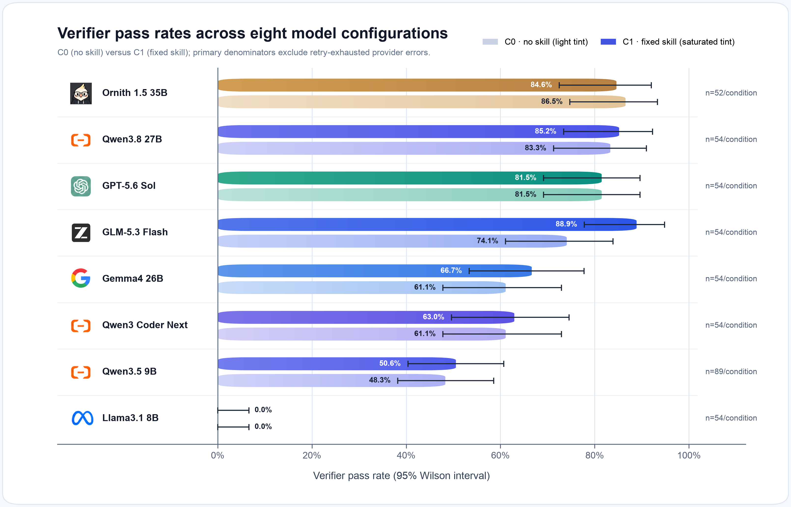
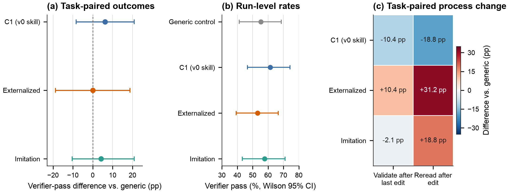

<a id="english"></a>
<p align="right"><strong>English</strong> &nbsp;|&nbsp; <a href="#zh">中文</a></p>

# How Written Skills Change Coding-Agent Performance?

Research question: when a coding agent receives a written skill, does it repair repository defects more successfully across models? Even when final pass rates do not change, does the skill alter how the agent reads, edits, and validates code?

## Key findings

- Across eight model configurations, the C1 effect is model dependent. The clearest positive result is GLM-5.3-Flash: verifier pass rises from 40/54 (74.1%) under C0 to 48/54 (88.9%) under C1, a task-paired gain of 14.8 percentage points with a 95% bootstrap interval of [3.7, 29.6] points ([S7_T1_model_condition_summary.csv](results/tables/s7/S7_T1_model_condition_summary.csv); [S7_T2_core_paired_differences.csv](results/tables/s7/S7_T2_core_paired_differences.csv)).
- For the weak target, qwen3.5:9b, C1 reduces the task-level rate of validation after the final edit by 25.0 percentage points while increasing verifier pass by 1.9 percentage points ([S7_T7_process_paired.csv](results/tables/s7/S7_T7_process_paired.csv); [S7_T2_core_paired_differences.csv](results/tables/s7/S7_T2_core_paired_differences.csv)).
- Ornith1.5:35b passed 45/52 usable C0 runs (86.5%) and 44/52 usable C1 runs (84.6%); its task-paired C1−C0 estimate was −1.9 percentage points with a 95% paired-bootstrap interval of [−16.7, 9.3] points ([Ornith completed summary](results/tables/s7/S7_T8_ornith_completed_summary.md)).
- For GLM-5.3-Flash, C1 also raises task-paired post-edit validation by 22.2 percentage points and increases the median trajectory from five to six tool calls. It is the clearest case in this panel where the fixed skill changes the prescribed process and improves verified repair.
- The central question is therefore not only whether a skill improves pass rate, but whether it changes the path through reading, writing, validating, and terminating. For qwen3.5:9b, C1 produces 25.0 percentage points less post-edit validation, slightly longer trajectories, and more rewrites and repeated actions; verifier pass moves from 48.3% to 50.6%. Relative to C1, v1 is explicitly referenced in 80% of runs and raises post-edit validation by 45.0 percentage points, yet does not change verifier pass ([S7_T4_process_metrics.csv](results/tables/s7/S7_T4_process_metrics.csv); [S7_T5_activation.csv](results/tables/s7/S7_T5_activation.csv); [S7_T6_exploratory.csv](results/tables/s7/S7_T6_exploratory.csv); [S7_T7_process_paired.csv](results/tables/s7/S7_T7_process_paired.csv)).
- A separate fresh-task mechanism study completed 192 qwen3.5:9b runs on 24 newly admitted development tasks. Relative to a length-matched generic prompt, C1, an externalized procedure, and trajectory imitation changed task-paired verifier pass by +6.25, 0.00, and +4.17 percentage points; all 95% paired-bootstrap intervals included zero. The externalized procedure nevertheless increased post-edit rereading by 31.3 points, directly reproducing the separation between workflow change and verified repair ([S8-b results](docs/s8b_results.md); [paired outcome table](results/tables/s8b/S8B_T2_task_paired_differences.csv)).

## Results at a glance

[](figures/s7/verifier_pass_rates_by_model.pdf)


### Fresh-task mechanism result

[](paper/figures/s8b_mechanism.pdf)

The left panel reports task-paired pass-rate differences from the length-matched generic control; the middle panel reports condition-level verifier pass; the right panel reports task-paired changes in validation and rereading.

## Paper

Read the complete report as a [PDF](paper/main.pdf) or inspect the [LaTeX source](paper/main.tex).

## Repository map

```text
config/           Locked protocol, prompt, split, runner, and schedule configuration.
tasks/            Frozen synthetic repair tasks, fixtures, manifests, and admission records.
harness/          Direct-agent runner, schedule execution, admission, and diagnostic utilities.
analysis/         Versioned outcome accounting, summaries, tests, table, and figure generators.
data/release/     De-identified released trajectory-derived records and their manifest.
results/tables/   Machine-readable tables, including formal S7 tables in results/tables/s7/.
figures/          Reproducible figures, plotting data, QA artefacts, and figure manifests.
docs/             Protocol locks, diagnostics, errata, result notes, and future-study plans.
paper/            Two-column manuscript source, bibliography, figures, and compiled PDF.
skills/           Frozen written-skill variants used by the experimental conditions.
```

## Research design and progression

The project was organized as an evidence chain rather than a sequence of prompt revisions. Each stage answered a specific design question before the next stage was allowed to begin.

### 1. Build tasks whose correctness can be checked independently

- **Design.** We created small repository-repair tasks with a buggy seed repository, a natural-language task specification, fixtures, and an external contract verifier. The formal pool contains 18 tasks: 12 `test_in` tasks from skill families A/B and six `test_out` tasks from transfer family C.
- **Why.** Repository repair exposes the complete inspect–edit–validate trajectory, while an external verifier separates a convincing final message from code that actually satisfies the contract. The in-family/transfer split tests both direct applicability and cross-skill transfer.
- **Result.** Every formal task passed admission checks against the intended solution, the frozen buggy seed, and shortcut candidates before model evaluation began.
- **Files.** [Split lock](docs/s3_split_lock.md) · [formal task manifest](tasks/formal_manifest.json) · [admission record](tasks/s3_admission.json)

### 2. Calibrate task difficulty before testing a skill

- **Design.** We preserved the early temperature-0 pilots as a separate cohort, probed the available sampling fields, and ran a multi-model calibration on pilot tasks before selecting the weak target and formal model panel.
- **Why.** A model–task combination at 0% or 100% pass rate cannot reveal much improvement or degradation. Calibration was therefore used to identify floor and ceiling regions and to decide where process-level analysis would be informative.
- **Result.** qwen3.5:9b was retained as the weak target and llama3.1:8b as a lower-bound configuration; stronger general and coding models supplied the comparison range.
- **Files.** [Sampling probe](docs/s0_sampling_probe.md) · [calibration protocol](docs/s4_calibration_protocol.md) · [calibration results](docs/s4_calibration_results.md)

### 3. Make the agent loop and outcome accounting auditable

- **Design.** For directly accessible models, we replaced the opaque CLI path with the locked r2 loop: a fixed tool set for listing, reading, editing, and executing commands; a 40-step limit; process-group timeout; request-level transport retries only; and stepwise response/tool metadata. GPT remained a Codex reference anchor. Terminal behaviors were stored as non-exclusive flags rather than one mutually exclusive label.
- **Why.** Early trajectories showed that an empty final message, no edit, a timeout, and verifier failure can occur together. Treating one of them as the sole outcome hid successful verifier results and made interface failures look like model failures.
- **Result.** The primary outcome became the Boolean `verifier.json.passed`. Retry-exhausted transport errors are excluded from the primary denominator, while timeouts and step-limit outcomes remain failures; legacy labels are retained only for audit.
- **Files.** [Runner design](docs/b1_r2_runner.md) · [outcome-flag specification](docs/outcome_flags_revision.md) · [verifier-pass erratum](docs/verifier_pass_erratum_20261010.md) · [versioned analysis patch](docs/s7_verifier_pass_analysis_patch_20261010.md)

### 4. Use development trajectories to identify candidate mechanisms

- **Design.** We diagnosed qwen3.5:9b trajectories and tested two development interventions without modifying frozen tasks or verifiers: `v1`, which made inspect–edit–validate requirements explicit, and `L3b`, which injected one fixed reminder after call 32.
- **Why.** The diagnosis separated failures that written instructions could plausibly address—missed constraints or absent validation—from interface failures, file corruption, and early termination. The fixed-position reminder tested whether a runtime guardrail could change late-trajectory behavior without adapting to outcome information.
- **Result.** `v1` increased post-edit validation by 45.0 percentage points relative to C1 but left verifier pass unchanged. `L3b` produced observable triggered behavior, but the small strata and baseline differences did not support an efficacy claim.
- **Files.** [Weak-model diagnosis](docs/s4_qwen35_diagnosis.md) · [`v1` intervention record](docs/d4_intervention.md) · [`L3b` results](docs/l3b_results.md) · [metric reconciliation](docs/l3b_metric_reconciliation.md)

### 5. Lock and run the eight-model comparison

- **Design.** The core contrast was C0 (no written skill) versus C1 (the frozen v0 skill) on all 18 tasks. qwen3.5:9b used five repetitions per task-condition; each of the other seven model configurations used three. The weak-model `v1` and `L3b` conditions were exploratory. Conditions, tasks, and repetitions were interleaved in deterministic schedules rather than executed in blocks. The complete matrix contained 1,086 scheduled runs: 936 core C0/C1 runs and 150 weak-model exploratory runs.
- **Why.** Holding the serialized prompt, tools, verifier, task, runner, and schedule rules fixed makes the presence of the skill block the intended C0/C1 difference. Interleaving reduces confounding from time-varying provider conditions, and repeated runs estimate within-task randomness. Statistical comparison is task-paired because tasks—not repeated samples—are the sampling units.
- **Result.** All 1,086 scheduled runs completed. The run ledger, exact prompt hashes, schedules, retry rules, and analysis code were frozen before formal comparison.
- **Files.** [Execution plan](docs/s7_execution_plan.md) · [execution lock](config/s7_execution_lock.yaml) · [schedule chain](docs/s7_schedule_chain_20261010.md) · [completion ledger](STATUS.md)

### 6. Compare verified success and process behavior separately

- **Design.** For each model, repetitions were first aggregated within task and condition; C1−C0 was then estimated with a fixed-seed task-paired bootstrap. Pass rate, post-edit validation, rereading, rewrite/loop behavior, steps, and terminal flags were analyzed as distinct outcomes.
- **Why.** A skill can alter the agent's procedure without changing whether the repair is correct. Measuring only pass rate misses behavioral activation; treating procedural compliance as success makes the opposite error.
- **Result.** Effects differed by model. GLM-5.3-Flash improved from 40/54 to 48/54 usable passes, a paired gain of +14.8 percentage points [3.7, 29.6], and post-edit validation rose by 22.2 points. qwen3.5:9b changed by +1.9 pass-rate points while post-edit validation fell by 25.0 points. Ornith1.5:35b changed by −1.9 points [−16.7, 9.3], and llama3.1:8b remained at the floor. These results make model capability a necessary dimension of skill evaluation.
- **Files.** [Condition summaries](results/tables/s7/S7_T1_model_condition_summary.csv) · [task-paired pass differences](results/tables/s7/S7_T2_core_paired_differences.csv) · [process metrics](results/tables/s7/S7_T4_process_metrics.csv) · [process contrasts](results/tables/s7/S7_T7_process_paired.csv) · [formal figures](figures/s7/) · [paper](paper/main.pdf)

### 7. Test alternative ways of presenting the procedure on new tasks

- **Design.** A second study used 24 newly authored and independently admitted tasks, one target model, four interleaved conditions—C1, an externalized step-by-step procedure, trajectory imitation, and a length-matched generic prompt—and two repetitions per task-condition, for 192 scheduled runs.
- **Why.** The length-matched generic condition distinguishes procedural content from the effect of adding more prompt text. Externalization tests direct instruction following; imitation tests whether showing a behavioral pattern transfers better than stating rules. New tasks broaden the mechanism check beyond the tasks used to develop the interventions.
- **Result.** Relative to the generic condition, paired pass-rate differences were +6.25 points for C1, 0.00 for externalization, and +4.17 for imitation; all three 95% paired-bootstrap intervals included zero. Externalization nevertheless increased post-edit rereading by 31.3 points [+14.6, +47.9]. The study therefore reproduced the central measurement result: a prompt can change the execution path without producing a corresponding change in verified repair.
- **Files.** [Analysis plan](docs/s8b_analysis_plan_20261015.md) · [execution lock](config/s8b_execution_lock.yaml) · [completion ledger](S8B_STATUS.md) · [full result note](docs/s8b_results.md) · [condition table](results/tables/s8b/S8B_T1_condition_summary.csv) · [paired outcomes](results/tables/s8b/S8B_T2_task_paired_differences.csv) · [process contrasts](results/tables/s8b/S8B_T5_process_paired_differences.csv) · [figure](paper/figures/s8b_mechanism.pdf)

## Reproduction

Run all commands from the repository root. 
### Environment

Python 3.14.0 was used. Python 3.11 or newer is the intended baseline; the pinned plotting stack is in [analysis/requirements-figures.txt](analysis/requirements-figures.txt).

<pre><code>python3 -m venv .venv
. .venv/bin/activate
python -m pip install --upgrade pip
python -m pip install -r analysis/requirements-figures.txt</code></pre>

Expected time: typically 1–3 minutes, depending on package-cache availability.

### Reproduce released analysis and figures

<pre><code>python -m analysis.make_tables
python analysis/check_report_numbers.py
python -m unittest analysis.test_figures
python -m analysis.make_s7_figures
python analysis/s8b_paper_analysis.py
python paper/make_paper_figures.py --figure s8b</code></pre>

Expected outputs are refreshed Markdown/CSV tables under [results/tables/](results/tables/), a successful cross-check against [results/tables/s7/](results/tables/s7/), six figure tests, five held-out figures plus a contact sheet under [figures/s7/](figures/s7/), and the fresh-task mechanism figure at [paper/figures/s8b_mechanism.pdf](paper/figures/s8b_mechanism.pdf). In the isolated-clone check, the original held-out sequence took under one minute after dependency installation.


### Re-run the experimental schedule

This creates new run artifacts and must use a new cohort/output location; it must not overwrite or be pooled with S7. Open-weight runs require <code>SOCLAAS_API_KEY</code> in the environment. GPT uses the local authenticated Codex CLI and has no repository-stored credential. Do not put credentials, raw responses, or reasoning payloads in Git.

<pre><code>export SOCLAAS_API_KEY
python harness/run_s7_schedule.py config/s7_schedules/qwen3_5_9b.tsv \
  --output-root data/new_cohort_runs --execute

# GPT reference-anchor schedule only
python harness/run_s7_codex_schedule.py config/s7_schedules/gpt_5_6_sol.tsv \
  --output-root data/new_cohort_runs --execute</code></pre>

These are audit entry points, not commands for reproducing the locked S7 cohort. They cannot be meaningfully run from a clean public clone without local provider access, the required Codex login for GPT, and explicit authorization for a new cohort. The direct runner specification is [here](docs/b1_r2_runner.md); the frozen original schedules are in [config/s7_schedules/](config/s7_schedules/).


## License

Source code is licensed under MIT. Released data, figures, tables, and documentation are licensed under CC BY 4.0. See [LICENSE](LICENSE).


---

<a id="zh"></a>
<p align="right"><a href="#english">English</a> &nbsp;|&nbsp; <strong>中文</strong></p>

# Written Skill 如何影响Coding Agent？

研究问题：给coding agent加入一段skill后，它在不同模型上会不会更容易修好仓库中的缺陷；即使最终通过率不变，它的阅读、修改和验证路径又会怎样变化。

## 核心结论

- 八个模型配置表明，C1 的作用取决于模型。最清楚的正向结果来自 GLM-5.3-Flash：C0 通过 40/54（74.1%），C1 通过 48/54（88.9%）；按任务配对的提升为 14.8 个百分点，95% bootstrap 区间为 [3.7, 29.6]（[S7_T1_model_condition_summary.csv](results/tables/s7/S7_T1_model_condition_summary.csv)、[S7_T2_core_paired_differences.csv](results/tables/s7/S7_T2_core_paired_differences.csv)）。
- 对弱目标模型 qwen3.5:9b，C1 使“最终一次编辑后再验证”的任务级比例降低 25.0 个百分点，通过率增加 1.9 个百分点（[S7_T7_process_paired.csv](results/tables/s7/S7_T7_process_paired.csv)、[S7_T2_core_paired_differences.csv](results/tables/s7/S7_T2_core_paired_differences.csv)）。
- Ornith1.5:35b 在 C0 下通过 45/52 条可用运行（86.5%），在 C1 下通过 44/52 条（84.6%）；按任务配对的 C1−C0 为 −1.9 个百分点，95% 配对 bootstrap 区间为 [−16.7, 9.3]（[Ornith 完成结果](results/tables/s7/S7_T8_ornith_completed_summary.md)）。
- 对 GLM-5.3-Flash，C1 还使按任务配对的“最终编辑后验证”增加 22.2 个百分点，并使中位工具调用数从 5 增加到 6。它是当前面板中最清楚的“skill 同时改变执行过程并提高修复通过率”的案例。
- 本研究的核心不只在于“skill 有没有提高通过率”，还在于检验：**即使最终通过率没有明显变化，skill 是否会改变智能体读取代码、写入文件、执行验证以及结束任务的路径。** 对 qwen3.5:9b，C1 与 v1 都观察到了这类轨迹层变化，C1 相对 C0：编辑后的验证行为减少了 25.0 个百分点，同时平均轨迹略长，并出现更多重写和重复动作；通过率从 48.3% 到 50.6%。
v1 相对 C1：v1 明确要求编辑后验证，模型对该指令的显式引用达到 80%，编辑后验证行为增加 45.0 个百分点；但通过率没有变化。（[S7_T4_process_metrics.csv](results/tables/s7/S7_T4_process_metrics.csv)、[S7_T7_process_paired.csv](results/tables/s7/S7_T7_process_paired.csv)）。
- 独立的新任务机制实验在 24 个新准入的开发任务上完成了 192 条 qwen3.5:9b 运行。与等长通用提示相比，C1、外显流程和轨迹模仿的任务配对通过率差分别为 +6.25、0.00 和 +4.17 个百分点，三个 95% 配对 bootstrap 区间都跨过 0；但外显流程使编辑后重读增加 31.3 个百分点。这直接说明：提示可以改变执行流程，却不一定提高最终修复通过率。见 [S8-b 结果](docs/s8b_results.md)和[配对结果表](results/tables/s8b/S8B_T2_task_paired_differences.csv)。

## 主结果与论文

完整报告见 [PDF](paper/main.pdf) 与 [LaTeX 源码](paper/main.tex)。主图已更新为八模型版本：[PNG](paper/figures/main_results.png) / [矢量 PDF](paper/figures/main_results.pdf)。


### 新任务机制结果

[](paper/figures/s8b_mechanism.pdf)

左图是各流程条件相对等长通用提示的任务配对通过率差；中图是各条件的 verifier 通过率；右图是验证与重读行为的任务配对变化。

## 目录

```text
config/           已锁定的实验协议、提示模板、数据划分、runner 与调度配置。
tasks/            冻结的合成修复任务、初始缺陷版本、测试夹具、清单和准入记录。
harness/          智能体运行、调度执行、任务准入和轨迹诊断工具。
analysis/         结局口径、统计汇总、单元测试、表格和图形生成代码。
data/release/     去标识化的轨迹派生数据及其完整性清单。
results/tables/   机器可读的结果表；正式 S7 表位于 results/tables/s7/。
figures/          可复现图、对应绘图数据、版式 QA 记录和图形清单。
docs/             协议锁、诊断报告、勘误记录、结果说明与后续研究方案。
paper/            论文源码、参考文献、论文专用图和已编译的 PDF。
skills/           各实验条件使用的、在锁定后不再改动的skill
```

## 实验方案与研究推进

整个项目不是围绕中间结果反复修改 prompt，而是按证据链分阶段推进。每一阶段先解决一个设计问题，再进入下一阶段。

### 1. 构建可以独立判定正确性的任务

- **实验方案。** 每道仓库修复任务都包含冻结的缺陷仓库、自然语言题面、测试夹具和外部合约 verifier。正式任务池共 18 题：12 个 `test_in` 任务来自 skill A/B，6 个 `test_out` 任务来自迁移 skill C。
- **为什么这样做。** 仓库修复可以完整记录“检查—修改—验证”的工具轨迹；外部 verifier 则把“最终回复看起来合理”和“代码真正满足要求”分开。`test_in`/`test_out` 划分同时检验 skill 在同类任务上的适用性和跨类型迁移。
- **实验结果。** 在模型运行前，18 个正式任务全部通过预期正确解、冻结错误种子和捷径候选的准入检查。
- **对应文件。** [数据划分锁](docs/s3_split_lock.md) · [正式任务清单](tasks/formal_manifest.json) · [任务准入记录](tasks/s3_admission.json)

### 2. 先校准模型与任务难度，再评估 skill

- **实验方案。** 温度为 0 的早期 pilot 被单独保留；随后检查各调用路径可用的采样字段，并在 pilot 任务上进行多模型校准，再确定弱目标模型和正式模型面板。
- **为什么这样做。** 如果某个“模型 × 任务”组合的通过率已经接近 0% 或 100%，skill 的提升或下降都很难被观测。校准用于定位地板和天花板区间，并判断哪些配置适合进一步分析执行过程。
- **实验结果。** qwen3.5:9b 被选为弱目标模型，llama3.1:8b 作为更低的能力边界；更强的通用模型与代码模型共同构成比较范围。
- **对应文件。** [采样探测](docs/s0_sampling_probe.md) · [校准协议](docs/s4_calibration_protocol.md) · [校准结果](docs/s4_calibration_results.md)

### 3. 构建可审计的 agent runner 与结局口径

- **实验方案。** 对可直接调用的模型使用锁定的 r2 agent loop：固定列目录、读文件、编辑文件和运行命令等工具，最多 40 步，设置进程组超时，只对未收到响应的传输错误重试，并逐步记录模型响应与工具调用。GPT 保留为 Codex 参考锚点。最终消息为空、没有编辑、工具错误、超时和 verifier 失败被记录为可以同时成立的标志。
- **为什么这样做。** 早期轨迹表明，“最终回复为空”“没有修改文件”“运行超时”和“verifier 未通过”可能同时发生。如果强行压成一个结局标签，会漏掉实际已经通过 verifier 的运行，也会把接口问题错误归因于模型能力。
- **实验结果。** 主结局统一改为 `verifier.json.passed`。重试耗尽的传输错误不进入主通过率分母；超时和撞到步数上限仍按失败计入；旧标签只用于审计对账。
- **对应文件。** [runner 设计](docs/b1_r2_runner.md) · [非互斥结局标志](docs/outcome_flags_revision.md) · [verifier-pass 勘误](docs/verifier_pass_erratum_20261010.md) · [版本化分析补丁](docs/s7_verifier_pass_analysis_patch_20261010.md)

### 4. 用开发轨迹定位可能的作用机制

- **实验方案。** 在不修改冻结任务与 verifier 的前提下，分析 qwen3.5:9b 的失败轨迹，并在开发数据上比较两个干预：`v1` 将“检查—修改—验证”要求写得更明确；`L3b` 在第 32 次调用后注入一次固定提醒。
- **为什么这样做。** 诊断需要先区分 skill 文字可能解决的失败——例如漏约束或修改后未验证——与接口异常、文件损坏和提前终止。固定位置提醒则用于检验运行时护栏能否改变轨迹后段的行为，而且不根据运行结果自适应。
- **实验结果。** `v1` 相对 C1 使修改后验证增加 45.0 个百分点，但 verifier 通过率没有变化。`L3b` 的触发后行为可以被观察到，但分层样本较小且基线层也有差异，不能据此得到效果结论。
- **对应文件。** [弱模型轨迹诊断](docs/s4_qwen35_diagnosis.md) · [`v1` 干预记录](docs/d4_intervention.md) · [`L3b` 结果](docs/l3b_results.md) · [指标口径对账](docs/l3b_metric_reconciliation.md)

### 5. 锁定并执行八模型正式比较

- **实验方案。** 核心条件为 C0（不提供 written skill）和 C1（提供冻结的 v0 skill），覆盖全部 18 个任务。qwen3.5:9b 每个“任务 × 条件”重复 5 次，其余七个模型各重复 3 次；`v1` 和 `L3b` 只作为弱模型探索条件。任务、条件和重复按固定种子交错排列，而不是按条件分块执行。完整矩阵为 1,086 条：936 条 C0/C1 核心运行，加 150 条弱模型探索运行。
- **为什么这样做。** 固定序列化 prompt、工具、verifier、任务、runner 和调度规则后，C0 与 C1 的预期差异只剩是否加入 skill 文本块。交错调度降低 provider 状态随时间变化造成的混淆；重复运行用于估计任务内随机性，正式统计仍以任务为抽样单位。
- **实验结果。** 1,086 条调度全部完成；prompt 哈希、运行顺序、重试规则、分母规则和分析代码都在比较前锁定并保留审计记录。
- **对应文件。** [正式执行方案](docs/s7_execution_plan.md) · [执行锁](config/s7_execution_lock.yaml) · [调度链说明](docs/s7_schedule_chain_20261010.md) · [完成状态账本](STATUS.md)

### 6. 分开比较“修复是否正确”和“执行过程是否改变”

- **实验方案。** 先在每个“任务 × 条件”内汇总重复运行，再对各模型的 C1−C0 做固定随机种子的任务级配对 bootstrap。同时分别分析通过率、修改后验证、修改后重读、整文件重写、重复循环、工具步数和终止标志。
- **为什么这样做。** skill 可能改变 agent 的操作方式，却不改变修复是否正确。只看通过率会漏掉行为激活；反过来，把遵循流程直接当成成功，也会把过程指标误当作任务结果。
- **实验结果。** 不同模型的结果方向不同。GLM-5.3-Flash 从 C0 的 40/54 提升到 C1 的 48/54，任务配对提升为 +14.8 个百分点 [3.7, 29.6]，修改后验证同时增加 22.2 个百分点。qwen3.5:9b 的通过率变化为 +1.9 个百分点，但修改后验证减少 25.0 个百分点。Ornith1.5:35b 为 −1.9 个百分点 [−16.7, 9.3]；llama3.1:8b 维持在地板。这说明评估 skill 时必须把模型能力作为一个独立维度。
- **对应文件。** [模型与条件汇总](results/tables/s7/S7_T1_model_condition_summary.csv) · [任务配对通过率差](results/tables/s7/S7_T2_core_paired_differences.csv) · [过程指标](results/tables/s7/S7_T4_process_metrics.csv) · [过程指标配对差](results/tables/s7/S7_T7_process_paired.csv) · [正式图表](figures/s7/) · [完整论文](paper/main.pdf)

### 7. 在全新任务上比较不同的流程表达方式

- **实验方案。** 第二组实验使用 24 个新编写并独立通过准入的任务、一个目标模型和四个交错条件：C1、外显化的逐步流程、轨迹模仿、等长通用提示。每个“任务 × 条件”重复 2 次，共 192 条调度。
- **为什么这样做。** 等长通用提示用于区分“流程内容本身”与“只是增加了更多 prompt 文本”；外显化条件直接检验明确步骤；轨迹模仿检验示范一种行为模式是否比陈述规则更容易迁移。全新任务则把机制检查扩展到没有参与前期干预设计的任务类型。
- **实验结果。** 相对等长通用提示，C1、外显流程和轨迹模仿的任务配对通过率差分别为 +6.25、0.00 和 +4.17 个百分点，三个 95% 配对 bootstrap 区间都跨过 0。外显流程仍使修改后重读增加 31.3 个百分点 [+14.6, +47.9]。这再次得到同一测量结论：prompt 能够改变执行路径，但这种变化不一定对应 verifier 通过率变化。
- **对应文件。** [分析方案](docs/s8b_analysis_plan_20261015.md) · [执行锁](config/s8b_execution_lock.yaml) · [完成状态账本](S8B_STATUS.md) · [完整结果说明](docs/s8b_results.md) · [条件汇总表](results/tables/s8b/S8B_T1_condition_summary.csv) · [任务配对结果](results/tables/s8b/S8B_T2_task_paired_differences.csv) · [过程指标配对差](results/tables/s8b/S8B_T5_process_paired_differences.csv) · [结果图](paper/figures/s8b_mechanism.pdf)

## 复现：

以下命令均从仓库根目录运行。

### 建立环境

实际验证使用 Python 3.14.0；

<pre><code>python3 -m venv .venv
. .venv/bin/activate
python -m pip install --upgrade pip
python -m pip install -r analysis/requirements-figures.txt</code></pre>


### 从发布内容重建表格与图形

<pre><code>python -m analysis.make_tables
python analysis/check_report_numbers.py
python -m unittest analysis.test_figures
python -m analysis.make_s7_figures
python analysis/s8b_paper_analysis.py
python paper/make_paper_figures.py --figure s8b</code></pre>

预期产物包括：更新后的 [results/tables/](results/tables/) Markdown/CSV、针对 [results/tables/s7/](results/tables/s7/) 的数值一致性检查、6 项图形测试、[figures/s7/](figures/s7/) 中的 5 张保留测试图与 contact sheet，以及 [paper/figures/s8b_mechanism.pdf](paper/figures/s8b_mechanism.pdf) 中的新任务机制图。原保留测试命令在依赖安装后的隔离克隆中运行时间不足 1 分钟。


### 启动一个新的实验队列

下列命令会创建新的运行记录。开源模型需要在环境中配置 <code>SOCLAAS_API_KEY</code>；GPT 通过本地已登录的 Codex CLI 运行。

<pre><code>export SOCLAAS_API_KEY
python harness/run_s7_schedule.py config/s7_schedules/qwen3_5_9b.tsv \
  --output-root data/new_cohort_runs --execute

# 仅用于 GPT 参考锚点的调度
python harness/run_s7_codex_schedule.py config/s7_schedules/gpt_5_6_sol.tsv \
  --output-root data/new_cohort_runs --execute</code></pre>

这两个入口是运行审计接口，并不是“重新生成原 S7”的手段。公开克隆如果没有本地 provider 权限、GPT 的 Codex 登录状态和针对新队列的明确授权，就不能实际启动它们。直接 runner 的设计见 [docs/b1_r2_runner.md](docs/b1_r2_runner.md)，原始冻结调度见 [config/s7_schedules/](config/s7_schedules/)。


## 许可证

代码采用 MIT 许可证；已发布的数据、图表和文档采用 CC BY 4.0。详见 [LICENSE](LICENSE)。
