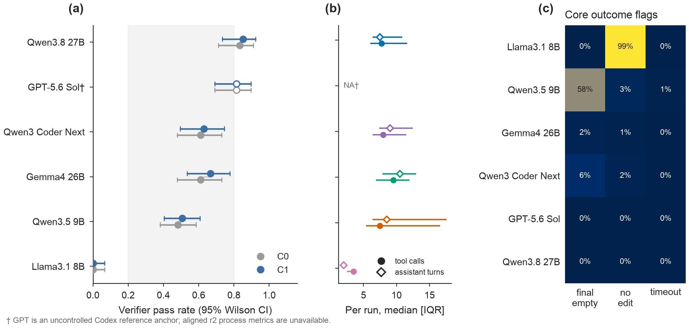

<a id="english"></a>
<p align="right"><strong>English</strong> &nbsp;|&nbsp; <a href="#zh">中文</a></p>

#  How Written Skills Change Cross-Model Coding Agents

This project asks whether a written skill changes repair success and process behavior for coding agents across models.

## TL;DR

- In the controlled six-model C0/C1 panel, pass-rate differences are small and inconsistent across models ([S7_T1_model_condition_summary.csv](results/tables/s7/S7_T1_model_condition_summary.csv); [S7_T2_core_paired_differences.csv](results/tables/s7/S7_T2_core_paired_differences.csv)).
- Process behavior and success decouple for the weak target: C1 changes validation-after-edit by −25.0 percentage points and pass rate by +1.9 percentage points ([S7_T7_process_paired.csv](results/tables/s7/S7_T7_process_paired.csv); [S7_T2_core_paired_differences.csv](results/tables/s7/S7_T2_core_paired_differences.csv)).
- The exploratory v1 condition changes validation-after-edit by +45.0 percentage points but pass rate by 0.0 percentage points ([S7_T7_process_paired.csv](results/tables/s7/S7_T7_process_paired.csv); [S7_T6_exploratory.csv](results/tables/s7/S7_T6_exploratory.csv)).
- With 18 tasks, the study resolves effects only on the order of 9–12 percentage points; all findings are exploratory and use synthetic repair tasks ([report.md](report.md), with task-level inputs in [S7_T2_core_paired_differences.csv](results/tables/s7/S7_T2_core_paired_differences.csv)).

## Main result



The publication-quality vector version is [Figure 1 (PDF)](figures/s7/S7_F1_main_results.pdf). Read the full [technical report](report.md) or the [paper PDF](paper/main.pdf) ([LaTeX source](paper/main.tex)).

## Repository map

```text
config/           Locked protocol, prompt, split, runner, and schedule configuration.
tasks/            Frozen synthetic repair tasks, fixtures, manifests, and admission records.
harness/          Direct-agent runner, schedule execution, admission, and diagnostic utilities.
analysis/         Versioned outcome accounting, summaries, tests, table, and figure generators.
data/release/     De-identified released trajectory-derived records and their manifest.
results/tables/   Machine-readable tables, including formal S7 tables in results/tables/s7/.
figures/          Reproducible figures, plotting data, QA artefacts, and figure manifests.
docs/             Protocol locks, diagnostics, errata, result notes, and future-study plans.
paper/            Single-column manuscript source, bibliography, figures, and compiled PDF.
skills/           Frozen written-skill variants used by the experimental conditions.
```

## Research path

The table below records the decision path rather than retroactively presenting a smooth success story. Frozen tasks, verifiers, skills, schedules, and prior outcomes were not changed after their applicable locks.

| Phase | Question and approach | Result and primary record |
|---|---|---|
| 1. Task pool and split lock | Build synthetic repair tasks with external contract verifiers; separate development diagnosis, development validation, in-skill test, and transfer test before later interventions. | All 18 formal tasks passed admission. See [split lock](docs/s3_split_lock.md), [formal manifest](tasks/formal_manifest.json), and [admission record](tasks/s3_admission.json). |
| 2. Sampling and calibration | Probe transport controls, preserve temperature-0 pilots as legacy evidence, then calibrate model–task difficulty under the direct runner. | Controls and their limitations were recorded rather than assumed; the weak model was retained as a floor condition. See [sampling probe](docs/s0_sampling_probe.md), [calibration protocol](docs/s4_calibration_protocol.md), and [calibration results](docs/s4_calibration_results.md). |
| 3. Runner and outcome diagnosis | Replace the opaque CLI path for open-weight models with a minimal direct runner; distinguish empty finals, no edits, tool errors, timeouts, and verifier outcomes. | The r2 runner, non-exclusive outcome flags, and verifier-pass correction were locked. See [runner design](docs/b1_r2_runner.md), [outcome revision](docs/outcome_flags_revision.md), and [verifier-pass erratum](docs/verifier_pass_erratum_20261010.md). |
| 4. Development interventions | Diagnose weak-model trajectories without touching frozen assets; evaluate v1 wording and a fixed call-32 reminder only on development data. | The recorded pilot is a negative result; L3b is a mechanism observation, not an efficacy claim. See [qwen diagnosis](docs/s4_qwen35_diagnosis.md), [v1 pilot record](docs/d4_intervention.md), [L3b results](docs/l3b_results.md), and [metric reconciliation](docs/l3b_metric_reconciliation.md). |
| 5. Locked formal evaluation | Lock prompts, schedules, hashes, outcome rules, and task-paired analysis before any test execution; interleave conditions rather than run them in condition blocks. | 870 scheduled S7 runs completed. See [execution plan](docs/s7_execution_plan.md), [execution lock](config/s7_execution_lock.yaml), [schedule chain](docs/s7_schedule_chain_20261010.md), and [batch ledger](STATUS.md). |
| 6. Formal analysis and corrections | Use <code>verifier.json.passed</code> as the primary outcome; exclude only retry-exhausted provider errors from the primary denominator; retain legacy labels for audit. | The locked tables and figures show no consistent C1 advantage; corrections remain visible. See [formal result note](docs/s7_formal_results_20261011.md), [S7 tables](results/tables/s7/), [figures](figures/s7/), and [analysis patch](docs/s7_verifier_pass_analysis_patch_20261010.md). |
| 7. Interpretation and next study | Test whether observed behaviors distinguish success, document task and provider incidents, and formulate a dev-only successor without changing S7. | Behavior–outcome evidence does not identify a success mechanism. S8 is a draft awaiting authorization. See [behavior cross-tabulation](docs/behavior_outcome_crosstab.md), [failure taxonomy](docs/weak_failure_taxonomy.md), and [S8 plan](docs/s8_plan.md). |

## Reproduction

Run all commands from the repository root. The analysis commands below were executed once in a fresh, isolated clone with Python 3.14.0 on 2026-10-11. The model-execution command was syntax-checked with <code>--help</code>, but deliberately not executed: doing so would make new provider requests and create a new experimental cohort.

### Environment

Python 3.14.0 was used. Python 3.11 or newer is the intended baseline; the pinned plotting stack is in [analysis/requirements-figures.txt](analysis/requirements-figures.txt).

<pre><code>python3 -m venv .venv
. .venv/bin/activate
python -m pip install --upgrade pip
python -m pip install -r analysis/requirements-figures.txt</code></pre>

Expected time: typically 1–3 minutes, depending on package-cache availability.

### Reproduce released analysis and figures

<pre><code>python -m analysis.make_tables
python analysis/check_report_numbers.py
python -m unittest analysis.test_figures
python -m analysis.make_s7_figures</code></pre>

Expected outputs are refreshed Markdown/CSV tables under [results/tables/](results/tables/), a successful cross-check against [results/tables/s7/](results/tables/s7/), six figure tests, and five S7 figures plus a contact sheet under [figures/s7/](figures/s7/). In the isolated-clone check, this sequence took under one minute after dependency installation.

The public release supports table and figure reproduction, but **not a from-scratch reanalysis of formal S7 runs**: the necessary <code>data/s7_runs/</code> directories and raw provider responses are deliberately not released. If an authorized holder has those private, frozen run directories, the gated regeneration command is:

<pre><code>python -m analysis.formal_s7_results
python -m analysis.make_s7_figures</code></pre>

It refuses to run unless the 870/870 completion and analysis-patch hash gate pass. That limitation is intentional and is documented in [the data-release policy](docs/data_release_policy.md).

### Re-run the experimental schedule

This creates new run artifacts and must use a new cohort/output location; it must not overwrite or be pooled with S7. Open-weight runs require <code>SOCLAAS_API_KEY</code> in the environment. GPT uses the local authenticated Codex CLI and has no repository-stored credential. Do not put credentials, raw responses, or reasoning payloads in Git.

<pre><code>export SOCLAAS_API_KEY
python harness/run_s7_schedule.py config/s7_schedules/qwen3_5_9b.tsv \
  --output-root data/new_cohort_runs --execute

# GPT reference-anchor schedule only
python harness/run_s7_codex_schedule.py config/s7_schedules/gpt_5_6_sol.tsv \
  --output-root data/new_cohort_runs --execute</code></pre>

These are audit entry points, not commands for reproducing the locked S7 cohort. They cannot be meaningfully run from a clean public clone without local provider access, the required Codex login for GPT, and explicit authorization for a new cohort. The direct runner specification is [here](docs/b1_r2_runner.md); the frozen original schedules are in [config/s7_schedules/](config/s7_schedules/).

## Data release

[data/release/](data/release/) contains de-identified <code>metadata.jsonl</code>, <code>verifier.jsonl</code>, <code>events.jsonl</code>, <code>actions.jsonl</code>, and [manifest.json](data/release/manifest.json) for completed pre-S7 r2 cohorts. It replaces absolute paths with placeholders and removes provider connection/authentication fields and reasoning fields.

Raw provider responses and reasoning are not released. Formal S7 run directories are also withheld because they contain raw trajectory material. The alternatives and trade-offs are described in [docs/data_release_policy.md](docs/data_release_policy.md). A redacted history scan is recorded in [docs/secret_scan_20261010.json](docs/secret_scan_20261010.json); credentials are never part of the repository contract.

## Key protocol conventions

- The primary outcome is the Boolean <code>passed</code> field in each <code>verifier.json</code>, not the historical single outcome label.
- Retry-exhausted transport failures (<code>provider_error_protocol</code>) are excluded from the primary numerator and denominator, then included as failures in a scheduled-run sensitivity view.
- Timeouts and max-step outcomes remain denominator failures when a verifier outcome is available.
- Repetitions estimate within-task variation; paired inference treats tasks as the sampling units.
- GPT-5.6 Sol is a sampling-uncontrolled Codex reference anchor and is never pooled into controlled direct-runner comparisons.
- The formal protocol was specified in a hash-locked, timestamped plan and lock manifest; it was not registered with an independent third-party registry.
- Legacy outcome labels remain available only for audit and correction comparisons.

## Status and known issues

- **S7:** complete (870/870); formal tables and figures are available in [results/tables/s7/](results/tables/s7/) and [figures/s7/](figures/s7/).
- **S8-lite:** not started; the candidate-mechanism study is a draft awaiting owner authorization. The repository currently contains [docs/s8_plan.md](docs/s8_plan.md), rather than a separate <code>docs/s8_prereg.md</code> file.
- **A04:** a documented task-text/verifier conflict; applicable development analyses report included and excluded views. See [A04 known defect](docs/a04_known_task_defect.md).
- **b09_phone:** two clustered historical hard timeouts, retained as a sensitivity issue rather than a demonstrated verifier defect. See [b09 known issue](docs/s7_b09_phone_known_issue_20261010.md).
- **GPT overwrite deviation:** 104 usage-limit failures were later overwritten with a new active cohort; the potential bias and retained manifest are documented in [the audit](data/s7_gpt_overwrite_audit_20261011.json) and [deviation note](docs/s7_postcompletion_gpt_rerun_deviation_20261011.md).

## License

Source code is licensed under MIT. Released data, figures, tables, and documentation are licensed under CC BY 4.0. See [LICENSE](LICENSE).

## Citation

Authors are pending. Replace the placeholder before external citation.

<pre><code>@misc{skilltraj2026,
  title  = {SkillTraj: Written Skills for Cross-Model Coding Agents},
  author = {Authors to be added},
  year   = {2026},
  note   = {Repository and technical report}
}</code></pre>

---

<a id="zh"></a>
<p align="right"><a href="#english">English</a> &nbsp;|&nbsp; <strong>中文</strong></p>

# Written Skill能否改变Coding Agent的表现？

研究问题：给coding agent加入一段skill后，它在不同模型上会不会更容易修好仓库中的缺陷；即使最终通过率不变，它的阅读、修改和验证路径又会怎样变化。

## 核心结论

- 在六个受控模型配置中，C1 相对 C0 的通过率点在小模型上有上升，对于强模型来说没有提升（[S7_T1_model_condition_summary.csv](results/tables/s7/S7_T1_model_condition_summary.csv)、[S7_T2_core_paired_differences.csv](results/tables/s7/S7_T2_core_paired_differences.csv)）。
- 对弱目标模型 qwen3.5:9b，C1 使“最终一次编辑后再验证”的任务级比例降低 25.0 个百分点，通过率增加 1.9 个百分点（[S7_T7_process_paired.csv](results/tables/s7/S7_T7_process_paired.csv)、[S7_T2_core_paired_differences.csv](results/tables/s7/S7_T2_core_paired_differences.csv)）。
- 本研究的核心不只在于“skill 有没有提高通过率”，还在于检验：**即使最终通过率没有明显变化，skill 是否会改变智能体读取代码、写入文件、执行验证以及结束任务的路径。** 对 qwen3.5:9b，C1 与 v1 都观察到了这类轨迹层变化，C1 相对 C0：编辑后的验证行为减少了 25.0 个百分点，同时平均轨迹略长，并出现更多重写和重复动作；通过率从 48.3% 到 50.6%。
v1 相对 C1：v1 明确要求编辑后验证，模型对该指令的显式引用达到 80%，编辑后验证行为增加 45.0 个百分点；但通过率没有变化。（[S7_T4_process_metrics.csv](results/tables/s7/S7_T4_process_metrics.csv)、[S7_T7_process_paired.csv](results/tables/s7/S7_T7_process_paired.csv)）。

## 主结果与论文


完整报告见 [PDF](paper/main.pdf) 与 [LaTeX 源码](paper/main.tex);矢量版主图见 [Figure 1 PDF](figures/s7/S7_F1_main_results.pdf)。

## 目录

```text
config/           已锁定的实验协议、提示模板、数据划分、runner 与调度配置。
tasks/            冻结的合成修复任务、初始缺陷版本、测试夹具、清单和准入记录。
harness/          智能体运行、调度执行、任务准入和轨迹诊断工具。
analysis/         结局口径、统计汇总、单元测试、表格和图形生成代码。
data/release/     去标识化的轨迹派生数据及其完整性清单。
results/tables/   机器可读的结果表；正式 S7 表位于 results/tables/s7/。
figures/          可复现图、对应绘图数据、版式 QA 记录和图形清单。
docs/             协议锁、诊断报告、勘误记录、结果说明与后续研究方案。
paper/            论文源码、参考文献、论文专用图和已编译的 PDF。
skills/           各实验条件使用的、在锁定后不再改动的skill
```

## 研究推进


| 阶段 | 解决方案 | 产物 |
|---|---|---|
| 1. 建任务池并锁定数据划分 | 先制作带独立合约 verifier 的小型仓库修复题；在观察任何正式测试轨迹前，把任务划为诊断集、版本选择集、同类保留集和跨技能保留集。 | 18 个正式任务全部通过正例、错误种子和捷径解的准入检查。见[划分锁](docs/s3_split_lock.md)、[正式任务清单](tasks/formal_manifest.json)与[准入记录](tasks/s3_admission.json)。 |
| 2. 校准模型、任务与采样设置 | 先检查实际 API/CLI 能否接受温度和随机种子；将温度为 0 的早期试跑独立保留，再以直接 runner 测量模型在任务池上的难度分布。 | 不把“请求了某个参数”误写成“参数已受控”；qwen3.5:9b 被记录为下限条件而非干预优化对象。见[采样探测](docs/s0_sampling_probe.md)、[校准协议](docs/s4_calibration_protocol.md)与[校准结果](docs/s4_calibration_results.md)。 |
| 3. 重建 runner 与结局口径 | 针对 CLI 路径中难以观察的响应字段，构建最小直接 runner；把最终消息为空、源文件未变、工具调用错误、超时和 verifier 判定拆成可同时成立的标志。 | 锁定 r2 runner，并将主结局改为 verifier 的 Boolean 字段而非旧的单一标签。见[runner 设计](docs/b1_r2_runner.md)、[结局字段修订](docs/outcome_flags_revision.md)与[verifier-pass 勘误](docs/verifier_pass_erratum_20261010.md)。 |
| 4. 仅用开发集理解失败与测试干预 | 不改题目、verifier 或既有轨迹；只在允许设计干预的诊断/验证数据上检查失败模式，并比较 v1 文本和固定第 32 次调用提醒。 | v1 的早期结果是应保留的负结果；L3b 只证明某些触发后行为可被观测，不能支持效果结论。见[qwen 诊断](docs/s4_qwen35_diagnosis.md)、[v1 记录](docs/d4_intervention.md)、[L3b 结果](docs/l3b_results.md)和[指标对账](docs/l3b_metric_reconciliation.md)。 |
| 5. 正式运行前冻结设计 | 在任何保留测试任务运行前，固定提示序列化、条件、调度、哈希、分母规则和按任务配对的分析方式；同一模型的条件按交错顺序运行。 | 锁定后的 S7 共完成 870 条调度运行。见[执行计划](docs/s7_execution_plan.md)、[执行锁](config/s7_execution_lock.yaml)、[调度监督器说明](docs/s7_schedule_chain_20261010.md)和[状态账本](STATUS.md)。 |
| 6. 用 verifier 结果完成正式分析 | 正式结果统一读取 <code>verifier.json.passed</code>；只将重试耗尽的传输失败移出主分母，旧标签继续保留以便对账。 | C1 没有显示跨模型一致的通过率优势；全部表、图和勘误均保留可追溯来源。见[正式结果说明](docs/s7_formal_results_20261011.md)、[S7 结果表](results/tables/s7/)、[S7 图](figures/s7/)与[分析补丁](docs/s7_verifier_pass_analysis_patch_20261010.md)。 |
| 7. 将解释与下一步分开 | 检查过程行为是否真正区分成功与失败，记录任务及 provider 事件，并只起草不回写 S7 的后续开发集研究。 | 已有行为—结果交叉表不足以把某个行为解释为成功机制；S8 仍只是待批准方案。见[行为—结果交叉表](docs/behavior_outcome_crosstab.md)、[机械失败分类](docs/weak_failure_taxonomy.md)与[S8 方案](docs/s8_plan.md)。 |

## 复现：

以下命令均从仓库根目录运行。

### 建立环境

实际验证使用 Python 3.14.0；

<pre><code>python3 -m venv .venv
. .venv/bin/activate
python -m pip install --upgrade pip
python -m pip install -r analysis/requirements-figures.txt</code></pre>


### 从发布内容重建表格与图形

<pre><code>python -m analysis.make_tables
python analysis/check_report_numbers.py
python -m unittest analysis.test_figures
python -m analysis.make_s7_figures</code></pre>

预期产物包括：更新后的 [results/tables/](results/tables/) Markdown/CSV、针对 [results/tables/s7/](results/tables/s7/) 的数值一致性检查、6 项图形测试，以及 [figures/s7/](figures/s7/) 中的 5 张 S7 图与 contact sheet。依赖安装完成后，隔离克隆中这组命令运行时间不足 1 分钟。


### 启动一个新的实验队列

下列命令会创建新的运行记录。开源模型需要在环境中配置 <code>SOCLAAS_API_KEY</code>；GPT 通过本地已登录的 Codex CLI 运行。

<pre><code>export SOCLAAS_API_KEY
python harness/run_s7_schedule.py config/s7_schedules/qwen3_5_9b.tsv \
  --output-root data/new_cohort_runs --execute

# 仅用于 GPT 参考锚点的调度
python harness/run_s7_codex_schedule.py config/s7_schedules/gpt_5_6_sol.tsv \
  --output-root data/new_cohort_runs --execute</code></pre>

这两个入口是运行审计接口，并不是“重新生成原 S7”的手段。公开克隆如果没有本地 provider 权限、GPT 的 Codex 登录状态和针对新队列的明确授权，就不能实际启动它们。直接 runner 的设计见 [docs/b1_r2_runner.md](docs/b1_r2_runner.md)，原始冻结调度见 [config/s7_schedules/](config/s7_schedules/)。


## 许可证

代码采用 MIT 许可证；已发布的数据、图表和文档采用 CC BY 4.0。详见 [LICENSE](LICENSE)。
